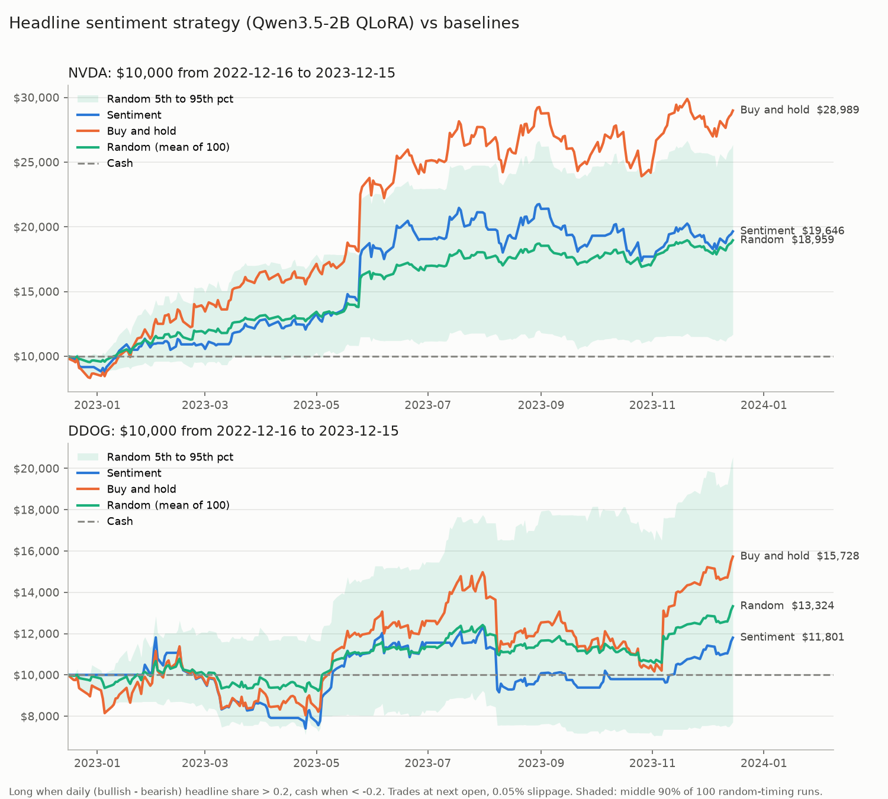

# Can our sentiment model trade? Backtest results

Model: Qwen3.5-2B QLoRA adapter (`~/poc1/adapters/qwen35-2b`, 0.919 accuracy on financial tweet sentiment).
Period: 2022-12-16 to 2023-12-15 (251 trading days). Starting capital $10,000. Run 2026-10-09.

## Short answer

**No. Sentiment did not beat buy and hold on either stock, and it did no better than trading on random days.**
On NVDA it made +96% while buy and hold made +190%. On DDOG it made +18% while buy and hold made +57%.
Against 100 random strategies with the same number of trades, it beat 57 on NVDA and 41 on DDOG, which is
what you would expect from a coin flip.

## Results

### NVDA (249 days with company-named headlines, long on 207 of 251 days)

| Strategy | Final value | Total return | Max drawdown | Trades (orders) | Win rate | Sharpe |
|---|---|---|---|---|---|---|
| Sentiment | $19,646 | +96.5% | -20.2% | 23 | 66.7% (8 of 12) | 1.78 |
| **Buy and hold** | **$28,989** | **+189.9%** | -18.3% | 1 | 100% (1 of 1) | **2.40** |
| Random, mean of 100 seeds | $18,959 | +89.6% | -16.4% | 23 | 69.8% | 1.87 |
| Cash | $10,000 | 0.0% | 0.0% | 0 | n/a | n/a |

### DDOG (146 days with company-named headlines, long on 158 of 251 days)

| Strategy | Final value | Total return | Max drawdown | Trades (orders) | Win rate | Sharpe |
|---|---|---|---|---|---|---|
| Sentiment | $11,801 | +18.0% | -37.3% | 21 | 63.6% (7 of 11) | 0.60 |
| **Buy and hold** | **$15,728** | **+57.3%** | -32.1% | 1 | 100% (1 of 1) | **1.06** |
| Random, mean of 100 seeds | $13,324 | +33.2% | -26.5% | 21 | 57.2% | 0.79 |
| Cash | $10,000 | 0.0% | 0.0% | 0 | n/a | n/a |

Trades counts buy and sell orders. Win rate is the share of round trips (buy then sell, or buy then the
end of the test) that made money. Sharpe is annualized from daily returns with a 0% risk-free rate.

## Why it did not work

1. **The headlines describe the past, not the future.** The daily score correlates with the *previous*
   session's move (+0.33 for NVDA, +0.16 for DDOG) but not with the *next* day's return (-0.10 and -0.03).
   Typical headlines: "Why Nvidia Stock Got Thumped on Thursday", "Datadog (DDOG) Stock Sinks As Market
   Gains". By the time they are published, the move has happened. The model reads them correctly, but
   correct sentiment about yesterday is not a trading signal.
2. **Being out of a rising stock is expensive.** 2023 was a huge year for NVDA (AI boom) and a good one for
   DDOG. Any strategy that spends time in cash will likely lag buy and hold in a year like that. The
   sentiment strategy sat out 44 days on NVDA and 93 on DDOG, and missed part of the rallies.
3. **The news data is coarse.** FNSPID only has a date per headline, not a time, so every headline had to
   be treated as after-close. That avoids lookahead but adds up to a day of delay to a signal that was
   already late.

## Why any result here could be luck

- **It is indistinguishable from random.** The sentiment return sits inside the middle 90% of random
  strategies with the same number of trades (NVDA: +17% to +164%; DDOG: -23% to +106%). Those ranges are
  very wide. One year and about 12 round trips per stock are far too few to separate skill from noise.
- **Two stocks, one year, both picked after the fact.** NVDA in 2023 is one of the best stock-years in
  recent memory. Any result on that period says more about the period than about the strategy.
- **No out-of-sample check.** A different threshold, window, or headline filter could change the numbers.
  We fixed them before running and did not tune, so the numbers above are honest, but also a single draw.
- **Possible overlap with training data.** The sentiment model was trained on financial news tweets whose
  dates may overlap this period (not checked). That would make the labels more accurate, not the trades more profitable, so it
  does not change the conclusion.

## Method

- **News:** FNSPID (`Zihan1004/FNSPID`, file `Stock_news/nasdaq_exteral_data.csv`, covers 2011 to 2023-12-16).
  Filtered to the ticker tag *and* headlines that name the company ("Nvidia"/"NVDA", "Datadog"/"DDOG"),
  because many tagged headlines are about other companies. Result: NVDA 1,887 headlines, DDOG 267.
- **Prices:** yfinance daily OHLC, split and dividend adjusted.
- **Window:** the 12 months ending at the news cutoff (2023-12-16), the most recent full year with both
  prices and news.
- **Daily score:** (bullish headlines - bearish headlines) / all headlines, using headlines dated from
  the previous trading day up to (not including) the trade day.
- **Rule:** score > +0.2 go long, score < -0.2 go to cash, otherwise keep the current position. Start
  in cash. All-in / all-out. Thresholds were chosen once and never tuned.
- **No lookahead:** a headline dated D only affects the trade at the open of the first trading day after D.
  Verified: no headline was used on a trade day dated on or before the headline itself.
- **Costs:** 0.05% slippage on every buy and every sell, filled at the open.
- **Random baseline:** start in cash and switch position on N random days, where N equals the
  sentiment strategy's number of orders. 100 seeds, metrics averaged.
- **Engine checks:** buy and hold matches a hand calculation to the cent; a flat-price round trip
  loses exactly 0.1%.

## Files

| File | What |
|---|---|
| `prep_news.py` | filter FNSPID to tickers, save per-ticker parquet, print coverage per year |
| `prep_prices.py` | download and cache prices from yfinance |
| `classify.py` | label headlines with the 2B adapter (GPU, about 1 minute) |
| `backtest.py` | strategies, metrics, chart (CPU, seconds) |
| `results.json` | all metrics and diagnostics |
| `equity_curves.png` | the chart above |

Cached data is in `~/scratch/poc1/backtest/`. To rerun: `source ~/poc1/env.sh; cd ~/poc1/backtest;
python classify.py; python backtest.py` (classification needs a GPU; prep steps need internet).

## Ideas if you want to push further

- Use headlines with real timestamps and trade intraday, before the move is fully priced in.
- Test across many stocks and several years, so the result is not one lucky or unlucky draw.
- Use sentiment as a filter on a long-only position (e.g. skip only strongly bearish days) rather than as
  the main signal, and compare against the same random baseline.
