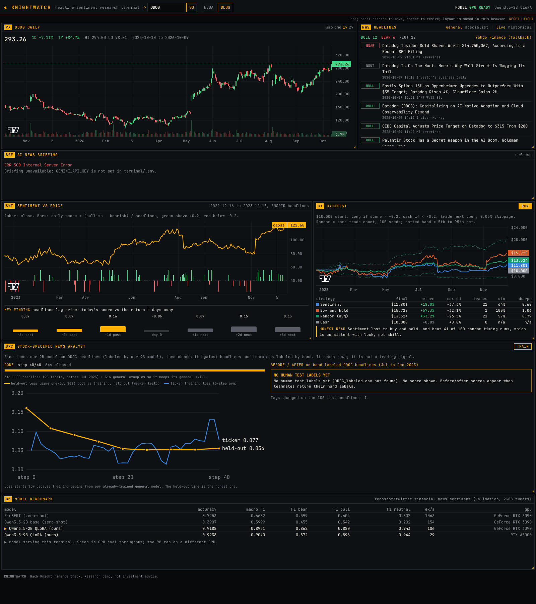

# KNIGHTWATCH

A terminal-style stock research dashboard for Hack Knight (finance track). It tags financial headlines with
our fine-tuned Qwen3.5-2B sentiment model and tests whether that sentiment predicts prices.
Short answer from our data: it does not. Headlines react to price moves instead of leading them.



## Panels

| Code | Panel | Data |
|---|---|---|
| PX | Daily candles + volume, 3mo / 6mo / 1y / 2y | yfinance, live |
| NWS | Headline feed, each tagged BULL / BEAR / NEUT by our model (hover for probabilities) | live: Yahoo Finance via yfinance; historical: FNSPID |
| SNT | Daily sentiment score under the price, plus the lead/lag correlation bars (the key finding) | FNSPID headlines, 2022-12-16 to 2023-12-15 |
| BT | Backtest: sentiment strategy vs buy and hold vs random timing vs cash, with an honest verdict | `~/poc1/backtest/backtest.py` |
| BM | Model benchmark: our QLoRA models vs FinBERT | `~/poc1/results/*.json` |

SNT and BT only work for tickers with cached historical headlines (NVDA, DDOG today). PX and NWS work for any ticker.

## Run it (on an Oscar GPU node)

Needs an interactive GPU session (Ampere: 3090 / A5000) for the model, e.g.
`interact -q gpu -g 1 -f ampere -m 32g -n 4`, or an Open OnDemand desktop/VS Code session on a GPU node.

**Backend + built UI (one command, one port):**
```bash
~/poc1/terminal/run_backend.sh          # serves API and UI on port 8000
```

**Frontend dev server with hot reload (optional, second terminal):**
```bash
cd ~/poc1/terminal/frontend && module load node-js/22.16.0-5pf2 npm/11.2.0-hzla && npm run dev   # port 5173, proxies /api to 8000
```
After UI changes, rebuild what port 8000 serves with `npm run build`.

First setup only (already done on 2026-10-09): `cp .env.example .env`, Python deps are in `~/venvs/fin`
(`backend/requirements.txt`), and `npm install` in `frontend/`.

## View it from your laptop

The compute node is not reachable from outside, so tunnel through the login node.
Find the node name with `squeue --me` (e.g. `gpu2101`), then on your laptop:

```bash
ssh -N -L 8000:gpu2101:8000 brrodrig@ssh.ccv.brown.edu
```
and open http://localhost:8000. For the dev server, forward 5173 the same way and open http://localhost:5173.
If you are in the Open OnDemand VS Code session, its Ports tab can forward 8000 instead.

## Test that it works

```bash
curl -s localhost:8000/api/health                                  # gpu: true, historical_tickers: [DDOG, NVDA]
curl -s "localhost:8000/api/prices?ticker=NVDA" | head -c 300
curl -s -X POST localhost:8000/api/classify -H 'content-type: application/json' \
     -d '{"texts":["Datadog crushes earnings, raises guidance"]}'  # Bullish, about 0.98
# Full headless UI test (loads every panel, runs the backtest, saves a screenshot):
PLAYWRIGHT_BROWSERS_PATH=~/scratch/pw-browsers ~/venvs/fin/bin/python scripts/ui_smoke_test.py http://127.0.0.1:8000 DDOG out.png
```
Verified on 2026-10-09 on gpu2101: all endpoints, and the UI test for NVDA and DDOG
(all panels render, 40 tagged headlines, drag and reload keeps the layout, no browser console errors). See `screenshot_nvda.png`, `screenshot_ddog.png`.

## API

| Endpoint | What |
|---|---|
| `GET /api/health` | GPU / model status, tickers with historical data |
| `GET /api/prices?ticker=&period=1y` | OHLCV bars + summary (cached per day) |
| `GET /api/headlines?ticker=&source=live\|historical&limit=` | headlines with model labels and probabilities |
| `POST /api/classify` `{"texts": [...]}` | raw model endpoint, up to 256 texts |
| `GET /api/sentiment?ticker=` | daily score + close, lead/lag correlations |
| `GET /api/backtest?ticker=` | metrics, equity curves, random band, diagnostics |
| `GET /api/benchmarks` | model vs FinBERT table |

## Model serving

- **Oscar (now):** `backend/classifier.py` loads Qwen3.5-2B in 4-bit + `~/poc1/adapters/qwen35-2b` on the
  first headline request (about 25 s), then classifies about 100 headlines/s. Labels are cached in
  `~/scratch/poc1/terminal/labels.json`, so repeat headlines are instant and survive restarts.
- **Modal (later):** `backend/modal_app.py` serves the same classifier. Setup steps are in its docstring.
  Set `MODEL_ENDPOINT_URL` and `MODEL_ENDPOINT_TOKEN` in `.env` and the backend uses Modal instead of a
  local GPU, so it can then run anywhere. **Not deployed or tested yet.**
- **No GPU and no endpoint:** the UI still works; new live headlines show as unclassified (----), and
  cached labels still appear.

## Config (.env)

All settings come from `terminal/.env` (template: `.env.example`). Keys are never hardcoded.
`MODEL_ENDPOINT_URL`, `MODEL_ENDPOINT_TOKEN`, paths, `PORT`, and placeholders for the stretch keys
(`GEMINI_API_KEY`, `ELEVENLABS_API_KEY`, `FINNHUB_API_KEY`).

## Data notes

- Internet works from Oscar compute nodes (checked 2026-10-09), so no login-node caching was needed.
- yfinance `Ticker.news` returned nothing on Oscar; the backend falls back to `yf.Search(ticker).news`.
  Relevance varies: DDOG results are mostly about Datadog, but NVDA results included general market
  pieces (e.g. Peter Lynch, an unrelated aircraft company). Finnhub's company-news endpoint
  (`FINNHUB_API_KEY`, free tier) would be a more targeted live source.
- Historical headlines are FNSPID (ends 2023-12-16), filtered to headlines naming the company.
  To add a ticker: add its name pattern in `~/poc1/backtest/classify.py` (`NAMES`), then run
  `python prep_news.py <FNSPID nasdaq csv> TICKER`, `prep_prices.py` (add the ticker), and `classify.py TICKER`.

## Layout (stretch 7, done)

Drag any panel by its header, resize from the bottom-right corner. The layout is saved per browser in
localStorage (`kw.layouts.v1`); RESET LAYOUT restores the default. Below 1000 px wide, panels stack.
Verified by the UI test: dragging the benchmark panel to the top survives a page reload.

## Stock-specific news analyst (stretch 8, done; human-labeled score pending)

The SPC panel fine-tunes our 2B model on one stock's headlines (labeled by our 9B model) in about 2 minutes,
shows progress and a loss chart, and compares the model before and after on headlines teammates labeled by hand.
It reads news; it is not a trading signal. Supported: NVDA, DDOG. The headline feed gets a General / Specialist toggle.
Until `~/poc1/specialist/labeling/<T>_labeled.csv` exists, it shows "NO HUMAN TEST LABELS YET" instead of a score.
Endpoints: `POST /api/specialist/train`, `GET /api/specialist/{info,status,stream,eval}`, `GET /api/headlines?model=specialist`.
A 24 s warmup runs at server start (set `SPECIALIST_WARMUP=0` to skip). Test: `scripts/specialist_smoke_test.py` (trains once).
Details: `~/poc1/specialist/PROGRESS_STRETCH8.md`.

## Live news, AI briefing, read-aloud (Finnhub and Gemini verified live; ElevenLabs pending its key)

- **News:** Finnhub company news (last 7 days) is the primary live source; Yahoo Finance is the fallback when the
  key is missing, Finnhub errors, or returns nothing. The feed shows which provider was used (amber with a hover
  reason when it fell back). Finnhub's company feed for large caps includes general market stories, so only headlines
  naming the company (short name from Finnhub's profile) or ticker are kept when at least 8 exist in 7 days; the feed
  shows the count (NVDA: 44 of 249). Without Finnhub, only 6 of 38 NVDA headlines mentioned Nvidia.
- **BRF panel (Gemini):** one paragraph (at most 90 words) summarizing today's model-tagged headlines (falls back to
  the last 24 hours, then the most recent, and says which). Grounded only in those headlines; tag counts are computed
  by us. Output is checked for prediction or advice phrases: regenerated once, else replaced by a plain non-AI summary.
  Cached per headline set. Endpoint: `GET /api/briefing?ticker=&refresh=`. Model `gemini-3.5-flash` (override with
  `GEMINI_MODEL`); answers that hit the token limit are never shown cut off.
- **READ ALOUD (ElevenLabs):** `GET /api/briefing/audio?id=` returns MP3 for a briefing this server generated
  (no arbitrary text), cached on disk.
- Keys live in `terminal/.env` (gitignored) and are re-read on every request, so no restart is needed after adding them.
  `/api/health` reports only whether each key is set.
- Test (adapts to which keys are set): `scripts/briefing_smoke_test.py`.

## Public site (Vercel + Oscar worker)

**Live: https://knightwatch-plum.vercel.app.** Storage: a Modal Dict behind `modal_kv/kv_app.py` (Upstash also
supported via `UPSTASH_REDIS_REST_URL/TOKEN`). Redeploy: `cd ~/poc1 && npx vercel@60.0.0 deploy --prod`.

Oscar cannot accept inbound connections, so Oscar pushes to Vercel:
- `frontend/api/kw.js` (one Vercel function, `vercel.json` rewrites `/api/*` to it) stores snapshots and a Train job
  queue in Upstash Redis. GET requests replay snapshots of the exact URLs the frontend uses, so the UI code is the
  same in both modes. Train needs `KW_TRAIN_PASSWORD`, runs one job at a time, refuses jobs while the worker is
  offline, and releases a job that sends no progress for 10 minutes. Read-aloud and live classification are off.
- `worker/kw_worker.py` runs the backend in-process and, in the foreground: pushes snapshots for NVDA and DDOG every
  15 minutes, checks for Train jobs every 20 s (Upstash free-tier budget), runs them on the GPU, and pushes progress every 3 s.
  Run: `source ~/poc1/env.sh; python ~/poc1/terminal/worker/kw_worker.py` (Ctrl-C to stop; `--once`, `--minutes N`).
- Secrets only in env vars: Vercel `KW_PUSH_SECRET`, `KW_TRAIN_PASSWORD` (+ Upstash vars from the integration);
  Oscar `terminal/.env`: `KW_API_URL`, `KW_PUSH_SECRET`.
- Local test without Vercel: `node frontend/scripts/dev-api.mjs 3001` (in-memory store) plus the worker with
  `KW_API_URL=http://127.0.0.1:3001`; browser test `scripts/public_smoke_test.py <url> <train password>`.
  Verified 2026-10-09 on Oscar: 11/11 checks, Train click to DONE 130 s. Not yet verified on real Vercel/Upstash.

## Not done yet (stretch)

All stretch items are built. Live verification of Finnhub, Gemini and ElevenLabs is waiting on the keys in `.env`.

## Files

```
terminal/
  run_backend.sh          one-command backend (+ built UI)
  .env.example            config template (copy to .env)
  backend/app.py          FastAPI app
  backend/classifier.py   Qwen3.5-2B + adapter wrapper (shared with Modal)
  backend/modal_app.py    Modal deployment (untested)
  frontend/               React 18 + Vite 5 + Tailwind 4 + lightweight-charts 4 + react-grid-layout
  scripts/ui_smoke_test.py  headless browser test
```
